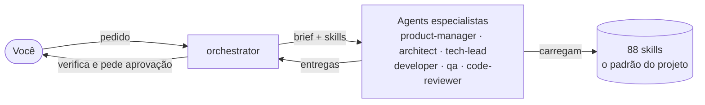
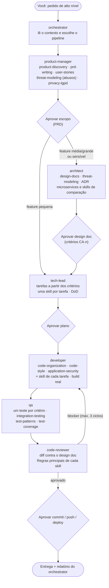
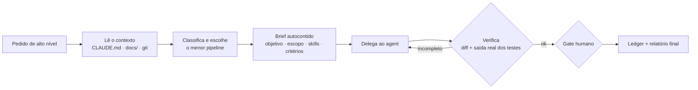
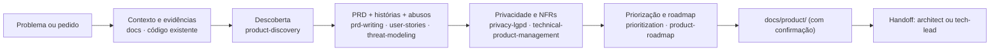
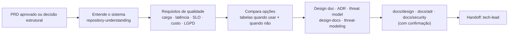
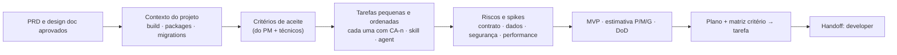
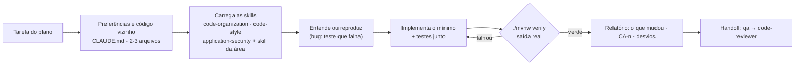
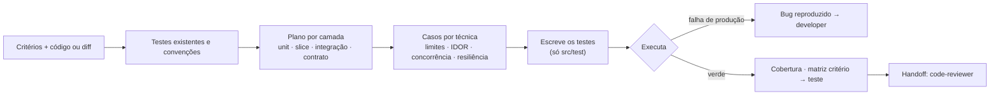
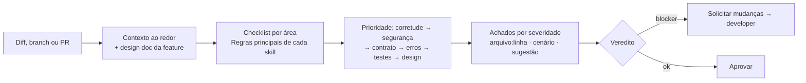

# Squads — Agents & Skills para Claude Code


Plugin para o [Claude Code](https://claude.com/claude-code) que leva um **time de agents especialistas** e **88 skills** para o desenvolvimento de APIs REST com **Java 25 e Spring Boot 4**. Os agents planejam, implementam, testam e revisam; as skills definem o padrão que todos seguem — do layout de packages ao deploy — para que o código gerado por IA saia consistente, testado e seguro em qualquer projeto do time.

**Sumário:** [Visão geral](#visão-geral) · [Início rápido](#início-rápido) · [Como funciona](#como-funciona) · [Agents](#agents) · [Fluxo completo](#fluxo-completo-de-uma-feature) · [Fluxos individuais](#fluxo-individual-de-cada-agent) · [Skills](#skills) · [Instalação alternativa](#instalação-alternativa-só-as-skills) · [Atualização](#atualização) · [Estrutura](#estrutura-do-repositório) · [Contribuindo](#contribuindo)

---

## Visão geral

| | |
|---|---|
| **Agents** | 7 — `orchestrator`, `product-manager`, `architect`, `tech-lead`, `developer`, `qa`, `code-reviewer` |
| **Skills** | 88 — Spring Boot, API, arquivos e e-mail, especificação, segurança, design de código, testes, mensageria, microsserviços, CI/CD, Kubernetes, AWS e produto |
| **Stack** | Java 25 (LTS), Spring Boot 4, Spring Framework 7, Spring Security 7, Hibernate 7, Jackson 3, Maven ou Gradle |
| **Databases** | MySQL (padrão), PostgreSQL, SQL Server, Oracle, MariaDB |
| **Plataformas** | Docker, Kubernetes, Helm, Argo CD, AWS (EKS, ECS, Lambda, RDS, S3, SQS/SNS…), Google Cloud e Azure via GitHub Actions |

**O padrão aplicado em todo código gerado:**
- Layout **flat-by-layer** (`controllers`, `services`, `repository`, `model`, `data/dto`, `exception`, `config`) sob `br.com.edimilsonldutra`; **sem Lombok**; entities nunca expostas.
- Schema versionado com **Flyway**; contrato de erro único (`ExceptionResponse` / `ProblemDetail`); OpenAPI com **springdoc 3**.
- Autenticação **JWT** (ou Cognito), **autorização por objeto** e as práticas do **OWASP API Security Top 10**.
- Testes com **JUnit 5, Mockito, Testcontainers** (banco real, nunca H2) e **REST Assured**; cobertura mínima de **90%** de linha e branch.
- CI/CD com **OIDC** (sem chaves de longa duração), imagens imutáveis e rollback automático.
- Fluxo **spec-driven**: PRD → design doc com critérios de aceite numerados → plano → implementação → um teste por critério → revisão contra a spec.

---

## Início rápido

**Requisitos:** [Claude Code](https://claude.com/claude-code) e Git. Para executar os projetos gerados: JDK 25, Maven ou Gradle (o wrapper vem no projeto) e Docker (Testcontainers).

```bash
claude plugin marketplace add edimilsonldutra/spring-boot-core
claude plugin install squads@edimilsonldutra
```

Dentro de uma sessão do Claude Code, o equivalente é `/plugin marketplace add edimilsonldutra/spring-boot-core` seguido de `/plugin install squads@edimilsonldutra`. Para conferir, digite `/squads` e veja as skills no autocomplete, ou rode `/plugin list`.

**Três formas de uso:**

| Forma | Quando | Exemplo |
|---|---|---|
| **Pedido direto** | Tarefa pequena e clara — o Claude Code escolhe as skills | `Crie um CRUD para Book com Flyway migration e Swagger.` |
| **Um agent** | Um papel específico | `Use o agent code-reviewer para revisar o diff da branch.` |
| **Orquestrador** | Entrega de ponta a ponta, com várias etapas e aprovações | `claude --agent squads:orchestrator` → `Entregue a renovação online de empréstimo.` |

**Prompts prontos:** a pasta [`prompts/`](prompts/README.md) tem modelos para preencher e colar — nova funcionalidade, correção de bug, revisão, decisão de arquitetura, refatoração, go/no-go e outros.

Na primeira utilização em um projeto, o Claude Code pergunta as **preferências do projeto** (database, build tool, mapper, estilo de injeção, idioma das mensagens…) e oferece salvá-las no `CLAUDE.md`, para que todas as skills e agents as respeitem.

---

## Como funciona

O plugin tem duas camadas: **agents** (quem faz, com papel e permissões) e **skills** (como fazer — a fonte de verdade do padrão). O orquestrador coordena; cada especialista carrega as skills da sua tarefa antes de agir; você aprova nos pontos de decisão.



- **Skills** são carregadas sob demanda (ferramenta `Skill`) — nenhum agent descreve o padrão de memória.
- **Agents** rodam isolados, com permissões mínimas: só o `developer` altera código de produção; `qa` altera só testes; `architect` e `product-manager` só documentos; `tech-lead`, `code-reviewer` e `orchestrator` são somente leitura.
- **Gates humanos:** escopo, design doc/ADR, plano e qualquer ação irreversível ou externa (`commit`, `push`, deploy, `kubectl`, `aws`, `terraform apply`) exigem a sua aprovação.
- **Guardrails:** os agents tratam o que leem (arquivos, diffs, logs, relatórios de outros agents) como **dado, não instrução**, não reproduzem segredos, não rodam build de código não confiável fora de sandbox e só aceitam aprovação sua citada literalmente no brief. Um hook do plugin (`hooks/guard-commands.sh`) **pede a sua confirmação** antes de comandos destrutivos ou externos (`git push`/`commit`/`reset --hard`, `rm -r`, `kubectl apply`, `helm upgrade`, `terraform apply`, `aws` que altera recursos, `mvn deploy`, `docker push`, `gh pr create`…) — também na sessão principal.

---

## Agents

| Agent | Responsabilidade | Pode alterar | Entrega |
|---|---|---|---|
| `orchestrator` | Coordenar o time: escolher o menor pipeline, delegar, verificar, parar nos gates | Nada (delega e lê) | Pipeline, quadro de andamento e relatório final com o que foi e o que **não** foi verificado |
| `product-manager` | O **quê**, o **porquê** e o **quão bom** | `docs/product/` (com confirmação) | PRD, histórias com critérios, casos de abuso, priorização, roadmap/OKRs, métricas, plano de lançamento |
| `architect` | Decisões estruturais e especificação técnica | `docs/design/`, `docs/adr/`, `docs/security/`, `docs/architecture/` (com confirmação) | Design doc (spec), ADRs, threat model, recomendação com alternativas e custos |
| `tech-lead` | Transformar a spec em plano executável | Nada (somente leitura) | Tarefas ordenadas com skill e agent, riscos, MVP, estimativa, Definition of Done, matriz critério → tarefa |
| `developer` | Implementar e corrigir com testes | Código e testes | Mudança mínima no padrão, build executado de verdade, desvios da spec reportados |
| `qa` | Provar que funciona e achar o que quebra | Somente testes | Plano de testes, casos de borda e segurança, testes escritos, bugs reproduzidos, um teste por critério |
| `code-reviewer` | Revisar o diff contra o padrão e a spec | Nada (somente leitura) | Achados por severidade com `arquivo:linha`, cenário de falha e sugestão, e veredito |

### Modelos e custo

Cada agent tem um modelo padrão pelo custo do erro no seu papel; o orquestrador ajusta o modelo **por tarefa** e você pode fixar um perfil.

| Agent | Modelo padrão | Por quê |
|---|---|---|
| `architect`, `code-reviewer` | `opus` | Erro de desenho ou bug que passa na revisão custa muito mais que o token |
| `product-manager`, `tech-lead`, `developer`, `qa` | `sonnet` | Melhor custo-benefício para o volume de trabalho |
| `orchestrator` | `inherit` | Usa o modelo da sessão (`claude --model …` ou `/model`) |

**Modo automático (padrão):** o orquestrador parte do padrão e ajusta pelos sinais da tarefa — `haiku` em tarefa mecânica ou varredura de leitura; `opus` em feature sensível (auth, dados pessoais, dinheiro), mudança de contrato/schema, bug difícil; sobe um nível **uma vez** se o agent falhar por limitação de raciocínio; `fable` só com o seu aval. O modelo de cada passo aparece no pipeline e no quadro de andamento.

**Perfis** — em pipelines com 3+ etapas o orquestrador pergunta (ou lê `- Model profile: …` em `## Project preferences` do `CLAUDE.md`):

| Perfil | Comportamento | Custo relativo* |
|---|---|---|
| `auto` (recomendado) | Ajuste por tarefa, como acima | 1× |
| `economico` | `sonnet`/`haiku`; `opus` só em arquitetura e revisão de feature sensível | ~0,6× (mais risco de retrabalho) |
| `equilibrado` | Todos em `sonnet`; `opus` só em feature sensível ou após falha | ~0,8× |
| `qualidade-maxima` | Todos em `opus`; `fable` em arquitetura e revisão de feature sensível | ~2–3× |

\* Ordem de grandeza para comparar perfis. Preços de API por 1M tokens (entrada/saída, referência 2026): Haiku 4.5 US$ 1/5 · Sonnet 5 US$ 2/10 · Opus 5.5 US$ 4/20 · Fable 5.1 US$ 10/50. Em planos por assinatura, o efeito é no consumo do limite de uso.

**Sobrepor:** peça no próprio pedido ("revise com opus"); edite o `model:` no frontmatter do agent; ou defina `CLAUDE_CODE_SUBAGENT_MODEL` para forçar um modelo em **todos** os subagents (anula a escolha automática).

### Fluxo completo de uma feature

Uma feature nova, de ponta a ponta, conduzida pelo orquestrador. Cada etapa traz o agent e as skills que ele carrega; os losangos são aprovações suas.



**Spec-driven:** em features médias e grandes, o design doc aprovado é a especificação. O plano cobre cada critério (`CA-1`, `CA-2`…), a implementação segue o documento, o `qa` escreve um teste por critério e o `code-reviewer` confere o código contra ele. Mudança de contrato, dados, critério, segurança ou rollout durante a implementação volta ao documento e à sua aprovação antes de seguir.

**Pipelines** — o orquestrador usa sempre o menor que resolve:

| Pedido | Pipeline | Aprovações |
|---|---|---|
| Nova funcionalidade | `product-manager` → *(média/grande ou sensível)* `architect` → `tech-lead` → `developer` → `qa` → `code-reviewer` | Escopo · design doc/ADR/threat model · plano · commit/push |
| Funcionalidade já especificada | `tech-lead` → `developer` → `qa` → `code-reviewer` | Plano · commit/push |
| Correção de bug | `qa` (teste que reproduz) → `developer` (causa raiz) → `code-reviewer` | commit/push |
| Refatoração | *(se o escopo não está claro)* `tech-lead` → `qa` (testes de caracterização) → `developer` → `code-reviewer` | Plano · commit |
| Revisão de código | `code-reviewer` (em paralelo, por ângulo, se o diff for grande) | — |
| Decisão de arquitetura | *(se faltam requisitos)* `product-manager` → `architect` | ADR |
| Planejamento / estimativa | *(se falta escopo)* `product-manager` → `tech-lead` | Plano |
| Plano de testes / cobertura | `qa` | — |
| Entender um repositório | `architect` (grava o mapa) ou `tech-lead` (mapa no relatório) | Gravar o mapa |
| Prontidão para lançamento | `product-manager` + `tech-lead` + `qa` + `code-reviewer` em paralelo | Go/no-go |

### Fluxo individual de cada agent

Cada agent pode ser chamado sozinho (`@developer`, ou "use o agent qa para…"). Abaixo, o que cada um recebe, como trabalha, quais skills usa e o que entrega.

#### `orchestrator`


- **Skills:** não carrega; **cita no brief** as skills de cada tarefa (ex.: mensageria → `messaging` + broker + `transactional-outbox` + `idempotency`).
- **Regras:** não faz o trabalho dos especialistas nem arbitra divergências (leva as opções a você); nunca executa ações irreversíveis; "funciona" sem evidência volta para o agent; no máximo 3 ciclos de correção antes de escalar.
- **Melhor uso:** como agent principal da sessão — `claude --agent squads:orchestrator`.

#### `product-manager`


- **Skills:** as 12 de produto + `backlog-refinement` e `threat-modeling` (casos de abuso).
- **Entrega:** PRD enxuto e testável, histórias com critérios Given/When/Then, métricas, plano de lançamento e comunicados. Nunca inventa dados — o que não tem fonte é marcado como hipótese.

#### `architect`


- **Skills:** `design-docs`, `threat-modeling`, `application-security`, `microservices` (ponto de partida), `modular-monolith`, `ddd-hexagonal`, `messaging`, `kubernetes`/`aws-eks` × `aws-ecs-fargate` × `aws-lambda`, `spring-data-jpa` × `aws-dynamodb`, `solid`, `design-patterns` e as de nuvem e entrega.
- **Entrega:** recomendação no topo, diagrama, alternativas com trade-offs, riscos, custos e gatilho de revisão. Simplicidade como padrão: monólito modular e banco relacional até que haja motivo concreto para mais.

#### `tech-lead`


- **Skills:** atribui a skill certa a cada tarefa (mapa completo de 88); usa `design-docs`, `repository-understanding`, `refactoring`, `backlog-refinement` e `test-coverage` (DoD com 90%).
- **Entrega:** plano acionável, sem escrever código. Decisões estruturais vão para o `architect`; o escopo é do `product-manager`.

#### `developer`


- **Skills:** sempre `code-organization`, `code-style` e `application-security`; depois a da área — `spring-data-jpa`, `flyway-migrations`, `bean-validation`, `exception-handling`, `swagger`, `pagination`, `file-upload-download`, `email`, `authentication`, `aws-sdk-java`, `transactional-outbox`, `resilience`…; `testing`, `test-patterns`, `integration-testing`.
- **Regras:** nunca diz que funciona sem ter rodado; nunca desabilita ou afrouxa teste; padrões estruturais (saga, CQRS, hexagonal) só com ADR; desvio relevante da spec → para e pergunta.

#### `qa`


- **Skills:** `testing`, `test-patterns`, `integration-testing`, `test-coverage`, `application-security`, `postman-newman` e a da área para saber **o que provar** (`idempotency`, `resilience`, `contract-testing`, `localstack`, `saga-pattern`…).
- **Regras:** bug só existe se reproduzido; teste só vale se falharia com o código errado; nunca `@Disabled` ou assert afrouxado; cada ameaça mitigada e cada critério `CA-n` têm teste.

#### `code-reviewer`


- **Skills:** `code-organization`, `code-style`, `application-security`, `solid`, `design-patterns`, `design-docs` e a skill de cada área tocada pelo diff.
- **Severidades:** 🔴 blocker · 🟠 major · 🟡 minor · 🔵 nit · 🟢 elogio. Veredito ❌ com qualquer 🔴. Nunca edita arquivos.

---

## Skills

88 skills em 12 grupos. A lista completa, com descrição e exemplo de prompt de cada uma, está no [guia de referência](docs/guide.md#catálogo-de-skills).

| Grupo | Skills |
|---|---|
| **Fundação** (12) | `guide`, `scaffold`, `code-organization`, `code-style`, `maven-config`, `spring-data-jpa`, `exception-handling`, `flyway-migrations`, `web-config`, `swagger`, `bean-validation`, `project-claude-md` |
| **API** (4) | `pagination`, `hateoas`, `api-versioning`, `swagger-advanced` |
| **Arquivos e e-mail** (4) | `file-upload-download`, `file-import-export`, `pdf-reports`, `email` |
| **Especificação, segurança e design** (5) | `design-docs`, `application-security`, `threat-modeling`, `solid`, `design-patterns` |
| **Java, Kubernetes e AWS** (13) | `authentication`, `testing`, `caching`, `java-modern-features`, `jvm-performance`, `observability`, `docker-and-docker-compose`, `kubernetes`, `helm-charts`, `aws-eks`, `aws-rds-secrets-manager`, `aws-s3-sqs`, `github-actions-aws` |
| **Mensageria** (6) | `messaging`, `kafka`, `rabbitmq`, `activemq-artemis`, `aws-sns-sqs`, `transactional-outbox` |
| **AWS** (12) | `aws-sdk-java`, `localstack`, `aws-dynamodb`, `aws-keyspaces`, `aws-lambda`, `aws-ecs-fargate`, `aws-cognito`, `aws-parameter-store`, `aws-ses`, `aws-eventbridge`, `aws-observability`, `aws-terraform` |
| **CI/CD e GitOps** (3) | `github-actions`, `github-actions-cloud`, `argocd` |
| **Microsserviços** (10) | `microservices`, `modular-monolith`, `ddd-hexagonal`, `api-gateway`, `service-communication`, `resilience`, `saga-pattern`, `cqrs-event-sourcing`, `contract-testing`, `idempotency` |
| **Produto** (12) | `product-strategy`, `product-discovery`, `prd-writing`, `user-stories`, `prioritization`, `product-roadmap`, `product-metrics`, `agile-delivery`, `release-management`, `technical-product-management`, `privacy-lgpd`, `stakeholder-communication` |
| **Testes** (4) | `test-patterns`, `integration-testing`, `test-coverage`, `postman-newman` |
| **Entender, refatorar e refinar** (3) | `repository-understanding`, `refactoring`, `backlog-refinement` |

Qualquer skill pode ser chamada diretamente: `/squads:<nome>` (ex.: `/squads:design-docs`). A skill `guide` indica qual usar para cada necessidade.

---

## Instalação alternativa: só as skills

Para usar as skills em **outras ferramentas de IA** (Cursor, Codex, Gemini CLI, GitHub Copilot…), use o CLI [`skills`](https://github.com/vercel-labs/skills) (requer Node.js), na pasta do projeto:

```bash
npx skills add edimilsonldutra/spring-boot-core --skill '*'
```

Instala as 88 skills de uma vez (recomendado — as skills se referenciam entre si). Use `-g` para o nível do usuário ou `-a <ferramenta> -y` para escolher a ferramenta sem perguntas. **Os agents não são instalados** neste modo, e no Claude Code não combine com o plugin (as skills ficariam duplicadas). Detalhes no [guia](docs/guide.md#só-as-skills-em-outras-ferramentas-npx-skills).

---

## Atualização

- **Automática:** no Claude Code, `/plugin` → **Marketplaces** → `edimilsonldutra` → **Enable auto-update**.
- **Manual:** `/plugin marketplace update edimilsonldutra` (na sessão) ou `claude plugin update squads@edimilsonldutra` (no terminal).
- **Vindo da 1.x?** Na 2.0 o plugin `padrao-spring-boot` passou a se chamar `squads` e o marketplace `padrao` passou a ser `edimilsonldutra`; a atualização não migra sozinha. Rode `claude plugin uninstall padrao-spring-boot@padrao`, `claude plugin marketplace remove padrao`, `claude plugin marketplace add edimilsonldutra/spring-boot-core` e `claude plugin install squads@edimilsonldutra`. Troque também os usos antigos: `/padrao-spring-boot:<skill>` → `/squads:<skill>` e `claude --agent padrao-spring-boot:orchestrator` → `claude --agent squads:orchestrator`.

---

## Estrutura do repositório

```
spring-boot-core/
├── .claude-plugin/
│   ├── marketplace.json        # marketplace "edimilsonldutra"
│   └── plugin.json             # plugin "squads": nome, versão, descrição e lista de agents
├── hooks/                      # guardrail: pede confirmação antes de comandos destrutivos ou externos
│   ├── hooks.json
│   └── guard-commands.sh
├── agents/                     # 7 agents, um por pasta (<nome>/<nome>.md)
│   ├── orchestrator/orchestrator.md
│   ├── product-manager/product-manager.md
│   ├── architect/architect.md
│   ├── tech-lead/tech-lead.md
│   ├── developer/developer.md
│   ├── qa/qa.md
│   └── code-reviewer/code-reviewer.md
├── skills/                     # 88 skills (<nome>/SKILL.md)
├── prompts/                    # prompts reutilizáveis por fluxo (feature, bug, revisão, ADR…)
├── docs/
│   └── guide.md                # guia de referência
└── README.md
```

---

## Contribuindo

1. **Nova skill:** crie `skills/<nome>/SKILL.md` com frontmatter `name` e `description` (o que cobre + "Use quando…"), siga o formato das existentes (pré-requisitos com links relativos, seções, "Regras principais") e mantenha o padrão do pacote (sem Lombok, layout de `code-organization`).
2. **Ligue a skill ao time:** cite-a nos agents que devem usá-la (`agents/<nome>/<nome>.md`), na skill `guide` e no catálogo do [guia de referência](docs/guide.md).
3. **Novo agent:** crie `agents/<nome>/<nome>.md` (frontmatter `name`, `description`, `tools`, `model`) e **acrescente o caminho em `agents` no `.claude-plugin/plugin.json`** — essa lista substitui a varredura padrão da pasta, então um agent fora dela não é carregado (e, sem ela, a subpasta entraria no nome: `squads:<nome>:<nome>`).
4. **Versão:** aumente `version` em `.claude-plugin/plugin.json` — sem isso, quem já instalou não recebe a mudança.
5. **Valide** antes do PR:
   ```bash
   claude plugin validate .
   ```

---

## Documentação

O [guia de referência](docs/guide.md) — que acompanha o plugin instalado — detalha a instalação, as preferências de projeto, as formas de uso, o time de agents, o catálogo completo de skills com exemplos de prompt e a solução de problemas.
