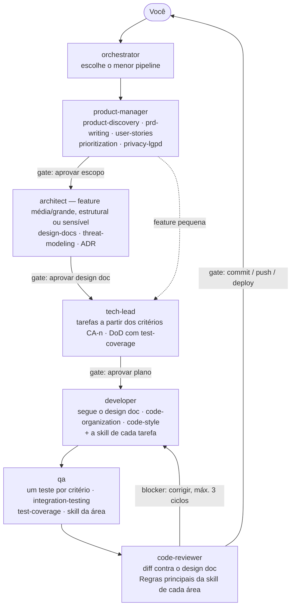

# Padrão Spring Boot — Agents e Skills para o Claude Code

**Ainda não instalou?** Vá direto para a **Parte 2** — são dois comandos. **Já instalou?** Este README viaja junto com o plugin, e tudo o que você precisa saber para usá-lo está nesta página.

Este plugin ensina o **Claude Code** (o assistente de código com IA) a construir REST APIs com Spring Boot 4 (Java 25) exatamente no padrão ensinado no curso: package layout, code style, security, testing, documentation — tudo. Ele traz duas coisas que trabalham juntas: um **time de agents** (product manager, architect, tech lead, developer, QA, code reviewer e um orquestrador) e as **skills** que esses agents seguem. Depois de instalado, basta pedir em linguagem natural (em inglês, português ou qualquer idioma) o que você quer, e o trabalho sai no padrão do curso.

Você não precisa ler nenhum código dentro deste plugin. Você não precisa abrir as pastas `agents/` nem `skills/`. Você só precisa saber como instalá-lo uma vez e depois como conversar com o Claude Code sobre ele. Essa é toda a curva de aprendizado.

> Construindo as mesmas APIs em Kotlin? Existe um plugin separado, `padrao-spring-boot-kt`, com as mesmas skills (cada uma com o prefixo `kt-`). Instale o da linguagem em que você está trabalhando — ou os dois.

---

## Parte 1 — Como o plugin funciona: agents usam skills

O plugin tem duas camadas:

- **Skills — o "como" e o padrão.** Uma skill é um conjunto escrito de instruções que ensina uma maneira específica de fazer algo: como escrever uma entity, uma migration, um teste de integração, um PRD, um manifest do Kubernetes. São 88 tópicos (Spring Boot, API, arquivos e e-mail, especificação, segurança e design de código, testes, mensageria, microsserviços, CI/CD, Kubernetes, AWS e produto). A skill é a **fonte de verdade do padrão** — ninguém responde de memória.
- **Agents — o "quem" e o papel.** Um agent é um especialista com um papel, permissões e um formato de entrega: o `developer` implementa, o `qa` prova e quebra, o `code-reviewer` revisa, o `architect` decide a estrutura, o `tech-lead` planeja e o `product-manager` define o quê e o porquê. Cada agent **carrega as skills da tarefa** antes de trabalhar. O `orchestrator` coordena o time: escolhe quais agents entram, em que ordem, e quais skills cada um deve ler.

```
Você ──pede──▶ orchestrator ──delega──▶ agents especialistas ──carregam──▶ skills (o padrão)
   ▲                │                                                          │
   └── aprova nos ──┘◀───────────── entrega verificada (código, testes, docs) ◀─┘
       gates humanos
```

Você pode usar o plugin em três níveis, todos explicados na Parte 3:

| Nível | Quando usar | Exemplo |
|---|---|---|
| **Só pedir** | Tarefa pequena e clara | "Crie a Flyway migration da tabela books." O Claude Code escolhe a skill sozinho. |
| **Chamar um agent** | Um papel específico: revisar, testar, planejar, desenhar | "Use o agent `code-reviewer` para revisar o diff." |
| **Chamar o orquestrador** | Trabalho de ponta a ponta, com várias etapas | "Entregue a renovação online de empréstimo." Ele monta o pipeline de agents. |

---

## Parte 2 — Instalando este plugin (passo a passo, do zero)

Se você já o instalou e está funcionando, pode **pular para a Parte 3**. Guarde esta seção para quando reinstalar em outro computador; para receber as atualizações, veja a **Parte 4**.

O plugin fica em um repositório público no GitHub: **[github.com/edimilsonldutra/spring-boot-core](https://github.com/edimilsonldutra/spring-boot-core)**. Você **não** precisa baixar nada à mão — o próprio Claude Code busca o repositório.

### O que você precisa antes de começar

- **Claude Code instalado no seu computador.** Se ainda não tem, acesse [claude.com/claude-code](https://claude.com/claude-code) e siga primeiro as instruções de instalação. Volte aqui quando conseguir abrir um terminal e digitar `claude` com sucesso.
- **Git instalado.** O Claude Code usa o Git para buscar o plugin no GitHub. Para conferir, digite `git --version` em um terminal; se der erro, instale em [git-scm.com](https://git-scm.com/downloads).
- Só isso. Você **não** precisa de conta no GitHub (o repositório é público), nem de Maven ou Java para instalar este plugin (você vai precisar de Java 25 e Maven — e Docker para os integration tests — mais tarde, claro, para realmente executar os projetos Spring Boot que ele ajuda a construir).

### Atalho — instalar com dois comandos no terminal

Se você está à vontade com o terminal, rode estes dois comandos em um terminal comum (Prompt de Comando, PowerShell ou Terminal no Mac), **fora** do Claude Code:

```
claude plugin marketplace add edimilsonldutra/spring-boot-core
claude plugin install padrao-spring-boot@padrao
```

O primeiro registra o repositório; o segundo instala o plugin com o scope **User** (disponível em todos os seus projetos). Depois, pule para o **Passo 4** para confirmar. Prefere fazer tudo dentro do Claude Code? Siga os passos abaixo — o resultado é o mesmo.

### Passo 1 — Abra um terminal e inicie o Claude Code

Abra um terminal (Prompt de Comando, PowerShell ou Terminal no Mac) em **qualquer** pasta — não precisa ser a pasta de um projeto, qualquer lugar serve para este passo. Digite:

```
claude
```

e pressione Enter. Você deve ver o prompt interativo do Claude Code aparecer.

### Passo 2 — Registre o repositório do plugin ("marketplace add")

Dentro do prompt do Claude Code (não um terminal comum — você já precisa estar dentro do `claude` do Passo 1), digite:

```
/plugin marketplace add edimilsonldutra/spring-boot-core
```

Pressione Enter. Este passo apenas **registra** o repositório do GitHub como uma fonte conhecida — ainda não instala nada. Você deve ver a mensagem `Successfully added marketplace: padrao`. Esse nome, `padrao`, é o que você vai usar no próximo passo.

### Passo 3 — Instale o plugin

Ainda dentro do Claude Code, digite:

```
/plugin install padrao-spring-boot@padrao
```

Pressione Enter. O Claude Code abre os detalhes do plugin; escolha instalar e ele vai perguntar em qual **scope**. Veja exatamente o que cada opção significa, em palavras simples:

| Opção | O que significa, em palavras simples | Quando escolher |
|---|---|---|
| **User** | "Disponível para mim, em todo projeto que eu abrir neste computador, para sempre." | **Escolha esta se estiver em dúvida.** É a opção mais simples e mais útil para um curso — você vai usar estas skills em vários projetos de prática diferentes. |
| **Project** | "Disponível somente dentro desta pasta/projeto, e compartilhada com qualquer pessoa que abrir este mesmo projeto." | Somente se você estiver trabalhando em um **projeto de equipe compartilhado** e quiser que seus colegas recebam automaticamente a mesma skill ao abri-lo. |
| **Local** | "Disponível somente dentro desta pasta/projeto, e somente para mim — não compartilhada com ninguém." | Raro — somente se você quiser um override específico do projeto que ninguém mais deva ver. |

**Se estiver em dúvida: escolha User.** Você sempre pode mudar depois (veja "Problemas comuns" abaixo).

### Passo 4 — Confirme que funcionou

Ainda dentro do Claude Code, digite uma barra:

```
/
```

...e comece a digitar `padrao-spring-boot`. Você deve ver uma lista de nomes de skills aparecer como sugestões (isso se chama "autocomplete"). Se você as vê, a instalação funcionou. Você também pode digitar:

```
/plugin list
```

e procurar por `padrao-spring-boot` na lista que aparece.

**Se nada aparecer**, veja "Problemas comuns" no final deste arquivo antes de pedir ajuda — a causa mais comum tem uma correção de uma linha.

---
## Parte 3 — Como realmente usar (esta é a parte que você vai usar todo dia)

Existem três maneiras de trabalhar com o plugin: pedir direto (o Claude Code escolhe a skill), chamar uma skill pelo nome, ou chamar um agent — inclusive o orquestrador, que coordena o time inteiro. Antes, uma coisa que acontece em qualquer uma delas:

### Na primeira vez, ele faz algumas perguntas — uma única vez

Na primeira vez que você usa qualquer skill deste plugin em uma conversa, o Claude Code faz uma pequena lista de perguntas sobre **como você quer que o projeto seja**, e depois lembra as respostas para todas as outras skills. Toda pergunta tem um default — responder "use os defaults" é uma resposta válida:

| Pergunta | Opções (a primeira é o default) |
|---|---|
| Comentários no código gerado? | **Não** / Sim |
| Qual database? | **MySQL** / PostgreSQL / SQL Server / Oracle / MariaDB |
| Onde ficam as annotations do Swagger? | **Uma interface `*ControllerDocs` separada** / direto no controller (veja a nota abaixo) |
| Qual build tool? | **Maven** / Gradle (Groovy ou Kotlin DSL) |
| Qual versão do Java? | **A última LTS** / qualquer LTS a partir da 17 / outro número (uma não-LTS gera um aviso) |
| `application.yml` ou `application.properties`? | **YAML** / properties |
| Idioma do texto que o client lê (mensagens de validation e de erro, textos do Swagger)? | **Inglês** / o seu idioma — nomes de classes, campos e métodos ficam **sempre** em inglês |
| Mapper Entity ↔ DTO? | **Dozer** / MapStruct |
| Estilo de dependency injection? | **Field (`@Autowired`)** / constructor |

Ele só pergunta o que for necessário: database e mapper só aparecem quando o projeto tem persistence, e a posição das annotations do Swagger só quando você usa Swagger. Uma pergunta que ficou de fora é feita depois, na primeira vez que uma skill precisar dela.

Em seguida ele se oferece para salvar suas respostas em uma seção `## Project preferences` do `CLAUDE.md` do seu projeto, para que a próxima conversa já comece sabendo. **Lombok nunca é usado — ele não é uma das opções.**

Duas observações honestas sobre estas escolhas:

- **Interface vs. Bean Validation.** Quando as annotations do Swagger ficam em uma interface `*ControllerDocs`, as annotations de validation (`@Valid`, `@Min`, …) também precisam ficar nessa mesma interface — colocá-las no override do controller quebra o controller inteiro em tempo de request. O Claude Code avisa isso quando você escolhe.
- **MySQL é o caminho que o curso percorreu de ponta a ponta.** Os outros quatro databases são suportados pelas skills — driver, módulo do Flyway, módulo do Testcontainers, imagem Docker, sintaxe SQL — mas são caminhos nos quais o curso não construiu um projeto inteiro, então leia a saída do Claude Code sobre eles com um pouco mais de cuidado. Maven e Gradle são ambos suportados: o `scaffold` cria qualquer um dos dois tipos de projeto, e `maven-config`, `docker-and-docker-compose` e `github-actions-aws` trazem os equivalentes de Gradle (dependencies, Flyway plugin, Dockerfile, pipeline). Os dois build tools foram executados de verdade.

### Forma 1 — Apenas descreva o que você quer, em linguagem natural

O Claude Code lê seu pedido e descobre, sozinho, quais skills se aplicam. Você não precisa saber nenhum nome de skill para isso funcionar. Exemplo:

> "Crie um CRUD para uma entity `Book` (title, author, price, launch date), com uma Flyway migration e documentação Swagger."

O Claude Code vai reconhecer que isso envolve três skills diferentes (`spring-data-jpa`, `flyway-migrations`, `swagger`) e aplicar as três automaticamente, no estilo correto.

### Forma 2 — Chame a skill pelo nome exato

Se você já sabe exatamente qual tópico quer, digite `/` seguido do nome da skill. Isso é útil quando seu pedido poderia corresponder a mais de uma skill e você quer ser 100% explícito sobre qual. Exemplo:

```
/padrao-spring-boot:authentication
```

Isso diz imediatamente ao Claude Code: "use a skill authentication, independentemente de como eu formule o resto da minha mensagem."

### Forma 3 — Chame um agent (ou o orquestrador)

Para um papel específico, chame o agent pelo nome (`@developer`) ou peça ao Claude Code: "use o agent `qa` para montar o plano de testes do BookService". Para um trabalho de ponta a ponta, abra a sessão com o orquestrador como agent principal:

```
claude --agent padrao-spring-boot:orchestrator
```

e descreva o objetivo: "Entregue a renovação online de empréstimo." Ele escolhe os agents, a ordem, e as skills que cada um deve carregar. A próxima seção mostra esse fluxo.

---

## O time de agents e o fluxo de trabalho

Cada agent tem um papel, permissões próprias e as skills que guiam seu trabalho. Todos leem `code-organization` (o layout e as preferências do projeto) e, conforme a tarefa, carregam as skills da área **com a ferramenta `Skill`** — nunca descrevem uma skill de memória.

| Agent | Papel | Pode alterar arquivos? | Skills que guiam o trabalho |
|---|---|---|---|
| `orchestrator` | 🎼 Coordenar o time, verificar entregas, parar nos gates humanos | **Não** (só delega e lê) | Não carrega skills: **cita no brief** de cada agent as skills da tarefa (ex.: mensageria → `messaging` + a do broker + `transactional-outbox` + `idempotency`) |
| `product-manager` | 📋 O **quê**, o **porquê** e o **quão bom** | Só docs em `docs/product/` (com confirmação) | As 12 de produto (`product-discovery`, `prd-writing`, `user-stories`, `prioritization`, `product-roadmap`, `product-metrics`, `release-management`, `privacy-lgpd`…) e `backlog-refinement` |
| `architect` | 🏛️ Decisões estruturais e ADR | Só docs/ADR (com confirmação) | **Começa por `microservices`**; compara opções com as tabelas "quando usar × quando não" de `modular-monolith`, `ddd-hexagonal`, `messaging` e brokers, `kubernetes`/`aws-eks` × `aws-ecs-fargate` × `aws-lambda`, `spring-data-jpa` × `aws-dynamodb` × `aws-keyspaces`, `authentication` × `aws-cognito`; critérios de `technical-product-management` e `privacy-lgpd` |
| `tech-lead` | 🧭 Plano, tarefas, riscos, estimativa, DoD | Não (somente leitura) | **Atribui uma skill a cada tarefa** do plano, para o `developer` e o `qa` executarem no padrão; DoD com `test-coverage` (90%); `repository-understanding`, `refactoring`, `backlog-refinement` |
| `developer` | 💻 Implementar e corrigir, com testes e build real | Sim (código e testes) | **Sempre** `code-organization` + `code-style`, e `application-security` em todo endpoint; depois a skill da área (`spring-data-jpa`, `flyway-migrations`, `bean-validation`, `exception-handling`, `swagger`, `authentication`, `maven-config`…); `aws-sdk-java` antes de qualquer AWS; `testing`, `test-patterns`, `integration-testing`. Padrões estruturais (saga, CQRS, hexagonal) **só com ADR** |
| `qa` | 🧪 Provar que funciona e achar o que quebra | Só código de teste | `testing`, `test-patterns`, `integration-testing`, `test-coverage`, `application-security` (IDOR, permissão, limites); cada ameaça do threat model vira teste; a skill da área diz **o que provar** (`idempotency`, `resilience`, `contract-testing`, `localstack`, `saga-pattern`…); **cada critério Given/When/Then** de `prd-writing`/`user-stories` vira caso de teste |
| `code-reviewer` | 🔍 Revisar o diff e dar o veredito | Não (somente leitura) | `code-organization` + `code-style`; para cada área do diff, usa a seção **"Regras principais"** da skill correspondente como **checklist** (violação = achado) |

**O fluxo completo de uma feature** — cada etapa com o agent e as skills que ele carrega:



**O design doc é a spec.** Em features médias e grandes, o fluxo é *spec-driven*: depois do PRD, o `architect` escreve o design doc (`design-docs`) com critérios de aceite numerados (`CA-1`, `CA-2`…); você aprova; o plano cobre cada critério, a implementação segue o documento, o `qa` escreve um teste por critério e o `code-reviewer` confere o código contra ele. Uma mudança de contrato, dados ou critério no meio do caminho volta para o documento e para a sua aprovação antes de seguir.

Nem todo pedido precisa do fluxo inteiro. O orquestrador usa **o menor pipeline que resolve**:

| Pedido | Pipeline | Gates humanos |
|---|---|---|
| Nova funcionalidade (do zero) | `product-manager` → *(feature média/grande, estrutural ou sensível)* `architect` (design doc, ADR e/ou threat model) → `tech-lead` → `developer` → `qa` → `code-reviewer` | Escopo · Design doc/ADR/threat model · Plano · commit/push |
| Funcionalidade já especificada | `tech-lead` → `developer` → `qa` → `code-reviewer` | Plano · commit/push |
| Correção de bug | `qa` (teste que reproduz) → `developer` (causa raiz) → `code-reviewer` | commit/push |
| Refatoração / dívida técnica | *(se o escopo não está claro)* `tech-lead` → `qa` (testes de caracterização **antes**) → `developer` → `code-reviewer` | Plano · commit |
| Revisão de código/PR | `code-reviewer` | — |
| Decisão de arquitetura | *(se faltam requisitos)* `product-manager` → `architect` | ADR |
| Planejamento / estimativa | *(se falta escopo)* `product-manager` → `tech-lead` | Plano |
| Plano de testes / cobertura | `qa` | — |
| Entender / mapear um repositório | `architect` (grava o mapa) *ou* `tech-lead` (mapa só no relatório) | Gravar o mapa |
| Prontidão para lançamento (go/no-go) | `product-manager` + `tech-lead` + `qa` + `code-reviewer` em paralelo (só leitura) | Go/no-go é seu |

**Regras do orquestrador:**
- **Não faz o trabalho dos especialistas** nem decide por eles: quando dois agents divergem, **leva as opções a você**.
- **Gates humanos:** para e pede sua aprovação para o **escopo** (PRD), a **decisão estrutural** (ADR), o **plano** e **qualquer ação irreversível ou externa** (`commit`, `push`, deploy, `kubectl`, `aws`, `terraform apply`). Ele **não executa** essas ações.
- **Verifica**: lê o que mudou e exige a saída real dos testes; "funciona" sem evidência volta para o agent. O que ficou **sem verificação** aparece marcado como tal no relatório.
- **Loops limitados:** revisão com bloqueio → `developer` corrige → `code-reviewer` revisa de novo, no **máximo 3 ciclos**; depois escala a você.
- **Como iniciar:** o melhor é abrir a sessão com ele como agent principal (`claude --agent padrao-spring-boot:orchestrator`), para que ele fale com você direto nos gates. Chamado como subagent ele também funciona, mas devolve cada aprovação no relatório em vez de perguntar. Se a ferramenta `Agent` não estiver disponível, ele **não finge delegar**: entrega um **runbook** com o brief de cada agent para você invocar.

**Bom saber:** como subagents, os agents não fazem perguntas no meio do trabalho nem conversam entre si — quando falta uma preferência, assumem o default da skill e dizem isso no relatório; dúvidas para outro agent também voltam no relatório. Salve suas preferências no `CLAUDE.md` (`project-claude-md`) para evitar suposições. Todos pedem confirmação antes de ações destrutivas ou externas (`git push`, `kubectl apply`, comandos `aws` que alteram recursos), nunca imprimem segredos e relatam honestamente o que **não** conseguiram verificar.

---

## Catálogo de skills (referência)

Estas são as skills que os agents carregam — e que você também pode chamar direto (Formas 1 e 2). Cada grupo diz quais agents o usam.

**Fundação (12 skills)** — comece por aqui

*Usadas por:* todos os agents leem `code-organization`; `developer` e `code-reviewer` leem também `code-style` e a skill da área (CRUD, migration, validation, erros, Swagger); `tech-lead` as atribui às tarefas; `qa` usa `spring-data-jpa`, `bean-validation` e `exception-handling` para testar o contrato.

| Nome da skill | Comando para chamá-la diretamente | O que faz, em palavras simples | Exemplo de prompt para copiar e colar |
|---|---|---|---|
| `guide` | `/padrao-spring-boot:guide` | Explica para que serve este pacote, como as skills se agrupam e qual usar para cada necessidade — o "índice" do pacote inteiro. | "O que este plugin faz, e qual skill eu preciso para adicionar login com JWT?" |
| `scaffold` | `/padrao-spring-boot:scaffold` | Cria um projeto Spring Boot novo do zero, a partir do Spring Initializr. **Ele pergunta** o group e o nome do projeto, a versão do Java (sugere a última LTS — se você escolher uma versão que não é LTS, ele avisa que não é uma boa ideia para produção), Maven ou Gradle (Groovy ou Kotlin DSL), YAML (default) ou `.properties`, e o idioma das mensagens que o client lê — depois pergunta quais building blocks opcionais incluir: persistence (Spring Data JPA + um database), Flyway migrations, exception handling, web config (CORS/content negotiation), Swagger/OpenAPI e Bean Validation, cada um ligado por default mas fácil de recusar um de cada vez. Ele escreve código real para o que você mantiver (usando um exemplo `Book` compartilhado), faz o build do projeto e roda os testes para provar que funciona. A application class é sempre `Startup`. | "Crie um novo projeto Spring Boot chamado library-api." |
| `code-organization` | `/padrao-spring-boot:code-organization` | Faz as perguntas acima, depois decide onde cada arquivo vai no seu projeto (folder layout) e as regras de naming das classes. É a base sobre a qual toda outra skill se apoia. | "Explique a package structure que este curso usa." |
| `code-style` | `/padrao-spring-boot:code-style` | As regras exatas de formatação Java usadas em todo o curso (sem Lombok, como escrever `equals()`/`hashCode()`, estilo de logger, etc.). Também é usada automaticamente, na maior parte, pelas outras skills. | "Revise esta classe e corrija seu estilo para seguir a convenção do curso." |
| `maven-config` | `/padrao-spring-boot:maven-config` | Configura o `pom.xml` do seu projeto — dependencies, plugins, o setup de testes e como consultar as versões mais recentes. | "Configure o pom.xml para um novo projeto Spring Boot com as dependencies deste curso." |
| `spring-data-jpa` | `/padrao-spring-boot:spring-data-jpa` | Cria entities (sem Lombok), relationships, repositories com queries custom e DTOs com mapper Dozer ou MapStruct — o núcleo de qualquer feature de CRUD. Também resolve N+1 e `LazyInitializationException` e testa os repositories contra um banco real. | "Crie um CRUD completo para uma entity `Book`: title, author, price, launch date." |
| `exception-handling` | `/padrao-spring-boot:exception-handling` | Configura como sua API responde quando algo dá errado (404s, 400s, erros customizados), em um único lugar central. | "Adicione um exception handling adequado para quando um Book não for encontrado." |
| `flyway-migrations` | `/padrao-spring-boot:flyway-migrations` | Escreve os arquivos de SQL migration que criam/alteram as tabelas do seu database, na sintaxe do database que você escolheu. | "Crie a Flyway migration para a tabela books." |
| `web-config` | `/padrao-spring-boot:web-config` | Configura CORS (quais sites têm permissão para chamar sua API) e permite que sua API responda em JSON, XML ou YAML se você quiser mais de um formato. **Ele vai fazer uma pergunta de sim/não sobre isso antes de fazer qualquer coisa** — é só responder. | "Configure o web config para este projeto." |
| `swagger` | `/padrao-spring-boot:swagger` | Adiciona documentação interativa da API que você pode navegar em uma página web (Swagger UI). | "Adicione documentação Swagger aos endpoints de Book." |
| `bean-validation` | `/padrao-spring-boot:bean-validation` | Rejeita input inválido na porta de entrada: uma request com title em branco recebe uma mensagem `400` clara por campo, em vez de um `500` vindo do database. Valida o body, path variables e query parameters, com as mensagens no idioma que você escolheu. | "Valide a request de Book: title obrigatório, price positivo." |
| `project-claude-md` | `/padrao-spring-boot:project-claude-md` | Escreve o arquivo `CLAUDE.md` do seu projeto (comandos, notas de teste, suas preferências salvas) para que o Claude Code conheça seu projeto em toda sessão futura. | "Crie o CLAUDE.md para este projeto." |

**API: paginação, links, versões e documentação avançada (4 skills)**

*Usadas por:* `developer` (implementar), `tech-lead` (atribuir às tarefas), `architect` (contrato e evolução da API), `qa` (limites, links e versões) e `code-reviewer` (paginação sem limite, quebra de contrato).

| Nome da skill | Comando para chamá-la diretamente | O que faz, em palavras simples | Exemplo de prompt para copiar e colar |
|---|---|---|---|
| `pagination` | `/padrao-spring-boot:pagination` | Listagens paginadas com `page`, `size` (com máximo) e `direction`, ordenação só por campos permitidos, formato estável (HAL ou `PagedModel`), custo do `count` e keyset para páginas profundas. | "Pagine a listagem de Book com no máximo 100 itens por página." |
| `hateoas` | `/padrao-spring-boot:hateoas` | Links nas respostas (`_links` em HAL): DTO com `RepresentationModel` e `@Relation`, links montados no service, links condicionais por estado, XML/YAML e testes. | "Adicione links HATEOAS aos endpoints de Book." |
| `api-versioning` | `/padrao-spring-boot:api-versioning` | Quando criar uma versão nova, v1 → v2 convivendo (um service, DTO e controller por versão), versionamento nativo do Spring 7, deprecação com `Deprecation`/`Sunset` e desligamento. | "Preciso trocar author por uma lista de authors sem quebrar quem usa a v1." |
| `swagger-advanced` | `/padrao-spring-boot:swagger-advanced` | OpenAPI como contrato: grupos por versão, respostas de erro comuns sem repetição, exemplos, `openapi.json` gerado no build com lint e detecção de breaking change, geração de clients. | "Separe a documentação por versão e bloqueie breaking changes no CI." |

**Arquivos e e-mail (4 skills)**

*Usadas por:* `developer` (implementar), `architect` (onde guardar arquivos, qual provedor de e-mail), `qa` (path traversal, linha inválida, rollback sem e-mail) e `code-reviewer` (upload inseguro, relay de spam, formula injection).

| Nome da skill | Comando para chamá-la diretamente | O que faz, em palavras simples | Exemplo de prompt para copiar e colar |
|---|---|---|---|
| `file-upload-download` | `/padrao-spring-boot:file-upload-download` | Upload e download seguros: nome gerado, proteção contra path traversal, tipo validado pela assinatura do arquivo, limites (413), download em stream com `Content-Disposition` correto e dono do arquivo checado. | "Crie os endpoints de upload e download da capa do livro." |
| `file-import-export` | `/padrao-spring-boot:file-import-export` | Importa XLSX/CSV validando cada linha (tudo ou nada, com o número da linha nos erros) e exporta uma página de dados em XLSX/CSV pelo header `Accept`, com proteção contra CSV injection. | "Crie a importação em massa de livros por planilha e a exportação em XLSX e CSV." |
| `pdf-reports` | `/padrao-spring-boot:pdf-reports` | Relatórios PDF com JasperReports 7: templates no formato novo, compilação com cache, sub-relatório, QR code, fontes no container e testes. | "Gere o relatório PDF da listagem de livros e o PDF de um livro com QR code." |
| `email` | `/padrao-spring-boot:email` | E-mail por SMTP com Spring Mail: timeouts, HTML com Thymeleaf, anexos, envio depois do commit e fora da request, Mailpit no desenvolvimento e GreenMail nos testes. Na AWS, veja `aws-ses`. | "Envie um e-mail de boas-vindas quando um usuário se cadastrar." |

**Especificação, segurança e design de código (5 skills)**

*Usadas por:* `architect` (escreve o design doc e o threat model, desenha os módulos), `developer` (segue o design doc; `application-security` em todo endpoint; `solid` e `design-patterns` ao desenhar classes), `tech-lead` (planeja a partir dos critérios do design doc; mitigações viram tarefas), `qa` (cada critério e cada ameaça mitigada vira teste), `code-reviewer` (revisa contra o design doc; checklist de segurança e de design) e `product-manager` (revisa os critérios de produto; casos de abuso no PRD).

| Nome da skill | Comando para chamá-la diretamente | O que faz, em palavras simples | Exemplo de prompt para copiar e colar |
|---|---|---|---|
| `design-docs` | `/padrao-spring-boot:design-docs` | O **design doc** (tech spec / SDD) que serve de **spec** no desenvolvimento orientado a especificação: template em `docs/design/`, critérios de aceite numerados (`CA-1`…) e testáveis, aprovação antes do plano, desvios registrados e a matriz critério → tarefa → teste. | "Escreva o design doc da renovação online de empréstimo a partir do PRD." |
| `application-security` | `/padrao-spring-boot:application-security` | Segurança da API pelo **OWASP API Security Top 10**: autorização por objeto (IDOR), mass assignment, limites e rate limit, injeção, SSRF, desserialização, security headers, segredos, logs de segurança, dependências e SBOM, e testes (incluindo SAST, secret scanning e ZAP). | "Faça uma revisão de segurança dos endpoints de empréstimo." |
| `threat-modeling` | `/padrao-spring-boot:threat-modeling` | Pensa em como a feature pode ser abusada **antes** de construir: diagrama com fronteiras de confiança, STRIDE, casos de abuso, prioridade e uma decisão por ameaça — cada mitigação vira tarefa e teste. Grava em `docs/security/`. | "Faça o threat model da renovação online de empréstimo." |
| `solid` | `/padrao-spring-boot:solid` | Os cinco princípios SOLID no código Spring Boot do pacote, com antes/depois, mais DRY, KISS, YAGNI e Lei de Demeter — e quando **não** aplicar (CRUD simples continua simples). | "Este BookService está difícil de testar. O que viola SOLID e como corrigir?" |
| `design-patterns` | `/padrao-spring-boot:design-patterns` | Padrões de projeto que aparecem de verdade numa API Spring Boot (Strategy, Factory, Adapter, Proxy/AOP, Observer, State, Specification…), onde o Spring já os usa, a armadilha da auto-invocação e os anti-padrões. | "Qual padrão usar para calcular multas diferentes por tipo de sócio?" |

**Java/Spring Boot, Kubernetes e AWS (13 skills)**

*Usadas por:* `developer` (implementar), `architect` (escolher plataforma, cache, identidade), `code-reviewer` (checklists de segurança, Docker, Kubernetes, CI) e `tech-lead`; `qa` usa `testing`, `authentication` e `jvm-performance`.

| Nome da skill | Comando para chamá-la diretamente | O que faz, em palavras simples | Exemplo de prompt para copiar e colar |
|---|---|---|---|
| `authentication` | `/padrao-spring-boot:authentication` | Login stateless com JWT e Spring Security 7: access/refresh token, senhas com BCrypt, autorização por permission. Para login gerenciado (MFA, social), veja `aws-cognito`. | "Adicione autenticação JWT a este projeto." |
| `testing` | `/padrao-spring-boot:testing` | Unit tests de service (JUnit 5 + Mockito + AssertJ, sem Spring) e slice tests de controller (`@WebMvcTest` + `@MockitoBean`), com `@ParameterizedTest`, `ArgumentCaptor` e o que testar ou não. | "Escreva os testes do BookService e do BookController." |
| `caching` | `/padrao-spring-boot:caching` | Cache com Caffeine (local) ou Redis/ElastiCache (distribuído), com TTL, invalidação e métricas. | "Cacheie o findById de Book com Redis." |
| `java-modern-features` | `/padrao-spring-boot:java-modern-features` | Java 17–25: records, sealed interfaces, pattern matching, text blocks, virtual threads e Scoped Values, e quando usar cada um. | "Devo ligar virtual threads neste projeto?" |
| `jvm-performance` | `/padrao-spring-boot:jvm-performance` | Tuning da JVM em container, pool de conexões, queries, startup, diagnóstico e teste de carga. | "A API está lenta e o pod leva OOMKilled. Me ajude a investigar." |
| `observability` | `/padrao-spring-boot:observability` | Actuator, health probes (liveness/readiness), métricas Micrometer/Prometheus, tracing e logs JSON. | "Adicione health checks e métricas a este projeto." |
| `docker-and-docker-compose` | `/padrao-spring-boot:docker-and-docker-compose` | Dockerfile (simples ou multi-stage com layers), usuário não-root, e docker-compose com o database. | "Dockerize este projeto com o MySQL." |
| `kubernetes` | `/padrao-spring-boot:kubernetes` | Manifests de Deployment, Service, Ingress, HPA, PDB, probes, secrets, Kustomize e troubleshooting. | "Crie os manifests do Kubernetes para este projeto." |
| `helm-charts` | `/padrao-spring-boot:helm-charts` | Chart Helm com values por ambiente, `--atomic` upgrade e rollback. | "Transforme estes manifests em um Helm chart." |
| `aws-eks` | `/padrao-spring-boot:aws-eks` | ECR, cluster EKS, permissões por pod (IRSA) em vez de chaves, ALB Ingress, logs e custos. | "Prepare o cluster EKS e o ECR para este projeto." |
| `aws-rds-secrets-manager` | `/padrao-spring-boot:aws-rds-secrets-manager` | RDS seguro (subnet privada, TLS, pool) e senhas no Secrets Manager, entregues sem ir para o Git. | "Conecte a aplicação ao RDS PostgreSQL com a senha no Secrets Manager." |
| `aws-s3-sqs` | `/padrao-spring-boot:aws-s3-sqs` | Upload/download no S3 (presigned URLs) e filas SQS com DLQ, testados com LocalStack. | "Guarde os uploads no S3 e publique um evento no SQS." |
| `github-actions-aws` | `/padrao-spring-boot:github-actions-aws` | Pipeline GitHub Actions → ECR → EKS autenticando por OIDC (sem access keys), com rollback automático. | "Crie o pipeline de CI/CD para o EKS." |

**Ordem sugerida para ir à AWS:** `docker-and-docker-compose` → `observability` → `kubernetes` → `aws-eks` → `aws-rds-secrets-manager` → `github-actions-aws` (e `aws-s3-sqs`, `caching`, `jvm-performance` conforme a necessidade).

**Mensageria (6 skills, incluídas neste pacote)**

*Usadas por:* `architect` (decidir se e qual broker), `developer` (implementar com outbox e consumer idempotente), `qa` (duplicata, DLQ, desordem) e `code-reviewer` (dual write, DLQ, serialização).

| Nome da skill | Comando para chamá-la diretamente | O que faz, em palavras simples | Exemplo de prompt para copiar e colar |
|---|---|---|---|
| `messaging` | `/padrao-spring-boot:messaging` | **Comece por aqui.** Diz se você precisa de mensageria, compara Kafka, RabbitMQ, Artemis, SQS/SNS e outras, e define as regras comuns (idempotência, DLQ, schema, segurança). | "Preciso notificar vários serviços quando um livro é criado. Qual broker devo usar?" |
| `kafka` | `/padrao-spring-boot:kafka` | Apache Kafka com Spring: producer seguro, `@KafkaListener`, keys/partições, DLT e retry, tópicos, MSK/Strimzi e testes. | "Publique BookCreated no Kafka e consuma em outro serviço." |
| `rabbitmq` | `/padrao-spring-boot:rabbitmq` | RabbitMQ com Spring AMQP: exchanges, quorum queues, DLQ, publisher confirms, retry com atraso e testes. | "Crie uma fila de processamento de pedidos no RabbitMQ com DLQ." |
| `activemq-artemis` | `/padrao-spring-boot:activemq-artemis` | JMS com ActiveMQ Artemis: `JmsTemplate`, `@JmsListener`, queues vs topics, redelivery e dead-letter no broker. | "Integre com o sistema legado via JMS usando Artemis." |
| `aws-sns-sqs` | `/padrao-spring-boot:aws-sns-sqs` | Fan-out SNS → várias filas SQS, filtros, DLQ/redrive, FIFO e IAM mínimo. | "Faça o fan-out do evento BookCreated para três filas SQS." |
| `transactional-outbox` | `/padrao-spring-boot:transactional-outbox` | Publica eventos **sem dual write** (outbox na mesma transaction) e torna o consumer idempotente. Vale para qualquer broker. | "Garanta que o evento só seja publicado se o livro for salvo, e nunca se perca." |

**Ordem sugerida:** `messaging` → a skill do broker escolhido → `transactional-outbox` (sempre que o evento nascer de uma mudança no banco) → `observability` (lag, DLQ) → `kubernetes`/`aws-eks`.

**AWS: serviços e integração com Spring Boot (12 skills, incluídas neste pacote)**

Complementam as skills `aws-eks`, `aws-rds-secrets-manager`, `aws-s3-sqs`, `aws-sns-sqs` e `github-actions-aws` listadas acima.

*Usadas por:* `architect` (comparar ECS × EKS × Lambda, RDS × DynamoDB × Keyspaces), `developer` (sempre `aws-sdk-java` primeiro) e `tech-lead`; `qa` usa `localstack` e `aws-terraform`; `code-reviewer` checa credenciais, IAM e Terraform.

| Nome da skill | Comando para chamá-la diretamente | O que faz, em palavras simples | Exemplo de prompt para copiar e colar |
|---|---|---|---|
| `aws-sdk-java` | `/padrao-spring-boot:aws-sdk-java` | **A base de todas as skills AWS:** SDK v2, credenciais sem chaves (IRSA/task role), clients singleton, timeouts, retries, LocalStack. | "Como configuro o SDK da AWS neste projeto do jeito certo?" |
| `localstack` | `/padrao-spring-boot:localstack` | Emula a AWS no seu computador e nos testes (S3, SQS, SNS, DynamoDB…): docker-compose, profile `local` com trava de segurança, Testcontainers, CI — e deixa claro o que ele **não** prova (IAM, desempenho). | "Configure o LocalStack para eu rodar e testar a integração com S3 e SQS sem conta AWS." |
| `aws-dynamodb` | `/padrao-spring-boot:aws-dynamodb` | DynamoDB com o Enhanced Client: modelagem por padrões de acesso, chaves, GSI, optimistic locking, paginação, IaC e testes. | "Guarde os pedidos no DynamoDB e busque por cliente." |
| `aws-keyspaces` | `/padrao-spring-boot:aws-keyspaces` | Amazon Keyspaces (Cassandra) com Spring Data Cassandra: conexão TLS/SigV4, modelagem por consulta, limitações. | "Migre o modelo Cassandra para o Amazon Keyspaces." |
| `aws-lambda` | `/padrao-spring-boot:aws-lambda` | Lambda em Java: handler puro ou Spring Cloud Function, cold start e SnapStart, SQS com falha parcial, Powertools, SAM. | "Crie uma Lambda que processa a fila SQS de livros." |
| `aws-ecs-fargate` | `/padrao-spring-boot:aws-ecs-fargate` | ECS + Fargate: task definition, execution role vs task role, ALB, circuit breaker, auto scaling, deploy por CI. | "Publique a API no ECS Fargate com ALB e rollback automático." |
| `aws-cognito` | `/padrao-spring-boot:aws-cognito` | Login gerenciado (MFA, social) com a API validando o JWT do Cognito via Spring Security Resource Server. | "Troque o JWT próprio pelo Cognito." |
| `aws-parameter-store` | `/padrao-spring-boot:aws-parameter-store` | Config externa no Parameter Store (SecureString) e feature flags com AppConfig, via `spring.config.import`. | "Mova a configuração para o Parameter Store." |
| `aws-ses` | `/padrao-spring-boot:aws-ses` | E-mail com SES: domínio/DKIM, sandbox, envio assíncrono, bounces e reputação, IAM por remetente. | "Envie e-mail de boas-vindas pelo SES sem bloquear a request." |
| `aws-eventbridge` | `/padrao-spring-boot:aws-eventbridge` | Barramento de eventos: regras, targets com DLQ, `PutEvents` seguro, Scheduler no lugar de `@Scheduled`, replay. | "Publique BookCreated no EventBridge e roteie para uma fila." |
| `aws-observability` | `/padrao-spring-boot:aws-observability` | Logs (retenção!), métricas (e o custo delas), traces com X-Ray/OpenTelemetry e alarmes acionáveis. | "Monte os alarmes essenciais da API na AWS." |
| `aws-terraform` | `/padrao-spring-boot:aws-terraform` | Infra como código: estado remoto, módulos por ambiente, IAM mínimo, plan/apply no CI com OIDC, scanners. | "Declare em Terraform o ECR, a fila e a tabela deste serviço." |

**Ordem sugerida:** `aws-sdk-java` → `aws-terraform` → a plataforma (`aws-ecs-fargate` *ou* `aws-eks` *ou* `aws-lambda`) → dados (`aws-rds-secrets-manager`, `aws-dynamodb`/`aws-keyspaces`) → integração (`aws-s3-sqs`, `aws-sns-sqs`, `aws-eventbridge`, `aws-ses`, `aws-cognito`, `aws-parameter-store`) → `aws-observability` → `github-actions-aws`.

**CI/CD e GitOps (3 skills)**

*Usadas por:* `developer` (escrever os workflows), `architect` (escolher entre deploy direto e GitOps), `tech-lead`, `qa` (validação de manifests) e `code-reviewer` (permissões, OIDC, segredos no pipeline).

| Nome da skill | Comando para chamá-la diretamente | O que faz, em palavras simples | Exemplo de prompt para copiar e colar |
|---|---|---|---|
| `github-actions` | `/padrao-spring-boot:github-actions` | **O CI, para qualquer destino:** build e testes (com Testcontainers), cobertura, imagem no GitHub Container Registry sem segredo extra, release por tag, CodeQL, Dependabot, permissões mínimas e proteção da branch. | "Crie o pipeline de CI deste projeto." |
| `github-actions-cloud` | `/padrao-spring-boot:github-actions-cloud` | Deploy no **Google Cloud** (Cloud Run, GKE) ou no **Azure** (Container Apps, AKS) com OIDC, sem chaves no GitHub, com segredos no Secret Manager/Key Vault e rollback. Na AWS, o equivalente é `github-actions-aws`. | "Faça o deploy da API no Cloud Run a cada push na main, com aprovação para produção." |
| `argocd` | `/padrao-spring-boot:argocd` | Entrega por **GitOps**: o Argo CD no cluster aplica o que está no Git. Cobre o repositório de configuração, Application/AppProject/ApplicationSet, migration do Flyway como `PreSync` hook, CI que só atualiza a tag da imagem, promoção por pull request, rollback por `git revert`, segredos fora do Git e a segurança do próprio Argo CD. | "Configure o Argo CD para implantar a API em dev, staging e prod, com aprovação por PR em produção." |

**Ordem sugerida:** `github-actions` (CI) → o deploy: `github-actions-aws` (AWS), `github-actions-cloud` (GCP/Azure) ou `argocd` (GitOps em qualquer Kubernetes, que usa os manifests de `kubernetes`/`helm-charts` e troca o job de "`kubectl apply`" por um que só commita a nova tag) → smoke pós-deploy com `postman-newman`.

**Arquitetura de microsserviços (10 skills, incluídas neste pacote)**

*Usadas por:* `architect` **decide** (começando por `microservices`) e registra o ADR; `tech-lead` planeja a partir da decisão; `developer` só aplica um padrão estrutural **com ADR**; `qa` testa falha parcial, contratos e compensações; `code-reviewer` cobra o ADR de todo padrão novo.

| Nome da skill | Comando para chamá-la diretamente | O que faz, em palavras simples | Exemplo de prompt para copiar e colar |
|---|---|---|---|
| `microservices` | `/padrao-spring-boot:microservices` | **Comece por aqui.** Quando dividir em serviços (e quando não), decomposição por bounded context, dados privados por serviço, o "distributed monolith", pré-requisitos de plataforma, migração com Strangler Fig e um checklist de decisão. | "Devemos migrar este monolito para microsserviços? Como dividir?" |
| `modular-monolith` | `/padrao-spring-boot:modular-monolith` | Monolito modular com **Spring Modulith**: módulos com fronteiras verificadas no build, eventos entre módulos, e o caminho para extrair um serviço depois. | "Organize esta aplicação em módulos por domínio, sem microsserviços." |
| `ddd-hexagonal` | `/padrao-spring-boot:ddd-hexagonal` | DDD tático e arquitetura hexagonal: aggregates, value objects (records), ports e adapters, ArchUnit — e quando **não** usar (CRUD). | "Modele o domínio de empréstimos com aggregates e hexagonal." |
| `api-gateway` | `/padrao-spring-boot:api-gateway` | Gateway e BFF com Spring Cloud Gateway: o que fazer e o que **não** fazer na borda, auth, rate limit, headers de identidade seguros, composição. | "Crie um gateway com rotas, JWT e circuit breaker para os serviços." |
| `service-communication` | `/padrao-spring-boot:service-communication` | Chamadas entre serviços: `RestClient`/`@HttpExchange`, timeouts, ACL de erros, descoberta sem Eureka, **auth serviço-a-serviço (zero trust)**, gRPC e service mesh. | "Faça o serviço de empréstimos chamar o catálogo com segurança." |
| `resilience` | `/padrao-spring-boot:resilience` | Timeout, retry (sem retry storm), circuit breaker, bulkhead e fallback honesto com Resilience4j e os recursos nativos do Spring 7, e como testar falhas. | "Proteja a chamada ao catálogo contra lentidão e falhas." |
| `saga-pattern` | `/padrao-spring-boot:saga-pattern` | Transação de negócio entre serviços com compensações: coreografia × orquestração, estado persistido, timeouts, Temporal/Step Functions. | "Implemente a criação de pedido com estoque e pagamento usando saga." |
| `cqrs-event-sourcing` | `/padrao-spring-boot:cqrs-event-sourcing` | CQRS em três níveis (comece pelo mais simples), projeções idempotentes e reconstruíveis, e Event Sourcing com event store, snapshots e LGPD — e quando **não** usar. | "A listagem está lenta e complexa. Devo usar CQRS?" |
| `contract-testing` | `/padrao-spring-boot:contract-testing` | Contratos entre serviços com **Pact** (broker, `can-i-deploy`) ou Spring Cloud Contract, contratos de eventos e detecção de breaking change do OpenAPI. | "Garanta que mudar o catálogo não quebre o serviço de empréstimos." |
| `idempotency` | `/padrao-spring-boot:idempotency` | `Idempotency-Key` em `POST` (replay, 409/422), consumers idempotentes, concorrência resolvida pelo banco e testes. | "Faça o endpoint de pagamento seguro contra retry e clique duplo." |

**Ordem sugerida:** `microservices` (decidir) → `modular-monolith` ou os serviços → `ddd-hexagonal` (se o domínio for rico) → `api-gateway` e `service-communication` → `resilience` + `idempotency` → `messaging` + `transactional-outbox` → `saga-pattern` / `cqrs-event-sourcing` (só se necessário) → `contract-testing` → `argocd`/`kubernetes`. Para decisões de arquitetura, peça ao agent `architect`.

**Produto: skills do perfil de PM (12 skills, incluídas neste pacote)**

*Usadas por:* `product-manager` (todas); `tech-lead` e `qa` consomem `prd-writing` e `user-stories` (critérios de aceite → tarefas e casos de teste); `release-management` e `privacy-lgpd` são usadas pelos 7 agents. São skills de **processo e documento** (sem código): trazem templates, critérios e os erros a evitar. **Nenhuma delas inventa dados** — números e pesquisa vêm de fontes reais; o resto é marcado como hipótese.

| Nome da skill | Comando para chamá-la diretamente | O que faz, em palavras simples | Exemplo de prompt para copiar e colar |
|---|---|---|---|
| `product-strategy` | `/padrao-spring-boot:product-strategy` | Visão e estratégia (diagnóstico → política → ações), posicionamento, análise competitiva, TAM/SAM/SOM sem inventar número, unit economics e business case. | "Monte o business case para a renovação online." |
| `product-discovery` | `/padrao-spring-boot:product-discovery` | Entender o problema antes de construir: quatro riscos, JTBD, entrevistas sem viés, hipóteses, experimentos baratos e a decisão seguir/ajustar/parar. | "Planeje a descoberta sobre por que sócios pagam multa." |
| `prd-writing` | `/padrao-spring-boot:prd-writing` | PRD que a engenharia consegue executar: problema, não-objetivos, requisitos testáveis, NFRs com números, métricas, riscos, plano de lançamento. | "Escreva o PRD da renovação de empréstimo." |
| `user-stories` | `/padrao-spring-boot:user-stories` | Histórias INVEST com critérios Given/When/Then, story mapping, fatias verticais, DoR/DoD e three amigos. | "Quebre este épico em histórias pequenas." |
| `prioritization` | `/padrao-spring-boot:prioritization` | RICE (com exemplo calculado), ICE, MoSCoW, Kano, WSJF; capacidade para dívida técnica; como dizer não; vieses. | "Priorize estes 12 pedidos contra o objetivo do trimestre." |
| `product-roadmap` | `/padrao-spring-boot:product-roadmap` | Roadmap Now/Next/Later orientado a resultado, OKRs bem escritos, planejamento trimestral e como responder pedidos de data. | "Monte o roadmap e os OKRs do próximo trimestre." |
| `product-metrics` | `/padrao-spring-boot:product-metrics` | North Star, AARRR/HEART, guardrails, plano de rastreamento sem PII, e A/B test com cálculo de amostra. | "Defina as métricas e o plano de instrumentação desta funcionalidade." |
| `agile-delivery` | `/padrao-spring-boot:agile-delivery` | Scrum/Kanban na prática, refinamento, forecast por vazão (Monte Carlo), métricas de fluxo, interrupções, dependências, retrospectiva e a parceria PM ↔ tech lead. | "Como planejar a sprint sem prometer data que não temos?" |
| `release-management` | `/padrao-spring-boot:release-management` | Deploy ≠ release: feature flags, rollout progressivo, critérios de aborto definidos antes, rollback (e seu limite com o banco), go/no-go e deprecação de API. | "Planeje o lançamento progressivo da renovação online." |
| `technical-product-management` | `/padrao-spring-boot:technical-product-management` | NFRs com número, SLO e error budget, API como produto, dívida técnica como decisão de produto, build × buy e custo de nuvem. | "Quais requisitos não funcionais devemos exigir deste serviço?" |
| `privacy-lgpd` | `/padrao-spring-boot:privacy-lgpd` | LGPD para produto e engenharia: bases legais, minimização, direitos do titular, eliminação ponta a ponta e checklist para o PRD. **Não é aconselhamento jurídico.** | "Quais requisitos de privacidade esta funcionalidade precisa?" |
| `stakeholder-communication` | `/padrao-spring-boot:stakeholder-communication` | Status com semáforo honesto, resumo executivo, decision log, release notes, comunicado de atraso, DACI e como negociar escopo. | "Escreva o comunicado de atraso do piloto." |

**Ordem sugerida:** `product-strategy` → `product-discovery` → `prd-writing` + `user-stories` → `prioritization` → `product-roadmap` → (handoff ao `tech-lead`) → `agile-delivery` → `release-management` → `product-metrics`; `privacy-lgpd`, `technical-product-management` e `stakeholder-communication` valem em todas as etapas.

**Testes: padrões, integração, cobertura e testes de API (4 skills, incluídas neste pacote)**

Complementam a skill `testing` (unit e slice). *Usadas por:* `qa` (o dono do tema), `developer` (testes junto com o código), `code-reviewer` (qualidade dos testes e cobertura) e `tech-lead` (DoD com 90%).

| Nome da skill | Comando para chamá-la diretamente | O que faz, em palavras simples | Exemplo de prompt para copiar e colar |
|---|---|---|---|
| `test-patterns` | `/padrao-spring-boot:test-patterns` | Os padrões que separam teste bom de teste ruim: Given/When/Then, **stub × mock × fake**, Test Data Builder, `@Nested`, valores-limite, property-based (jqwik), TDD/BDD, **test smells** e **testes flaky** (causas e cura). | "Revise estes testes: estão frágeis? Que padrões aplicar?" |
| `integration-testing` | `/padrao-spring-boot:integration-testing` | Testes de integração com **banco real em container** (Testcontainers singleton, nunca H2), `@SpringBootTest` + REST Assured, **isolamento de dados**, contrato de erro, segurança, migrations e cache de contexto. | "Escreva os testes de integração do CRUD de Book." |
| `test-coverage` | `/padrao-spring-boot:test-coverage` | **JaCoCo** (Maven e Gradle), branch coverage, **padrão de 90%** de linha e branch (com cobertura do código novo + catraca para subir um legado), gate no CI (Codecov/Sonar) e **mutation testing (PIT)** para provar que os testes pegariam um bug. | "Configure a cobertura com gate no pipeline e me diga o que está descoberto." |
| `postman-newman` | `/padrao-spring-boot:postman-newman` | Coleção Postman versionada e executada pelo **Newman** contra a aplicação rodando: login JWT automático, ids encadeados, contrato de erro, sem segredos no Git, no CI com docker compose e como **smoke test pós-deploy**. Complementa (não substitui) os testes de integração. | "Monte uma coleção Postman do CRUD de Book e rode no pipeline com o Newman." |

**Ordem sugerida:** `testing` → `test-patterns` → `integration-testing` → `test-coverage` (→ `contract-testing` entre serviços; → `postman-newman` contra a aplicação implantada). Lembre: **cobertura mostra o que não foi testado; não prova qualidade**.

**Entender, refatorar e refinar (3 skills, incluídas neste pacote)**

*Usadas por:* `repository-understanding` — `architect` (grava o mapa), `tech-lead`, `developer`, `qa` e `code-reviewer`; `refactoring` — `qa` (rede de segurança), `developer` e `code-reviewer`; `backlog-refinement` — `product-manager` com `tech-lead` e `qa`.

| Nome da skill | Comando para chamá-la diretamente | O que faz, em palavras simples | Exemplo de prompt para copiar e colar |
|---|---|---|---|
| `repository-understanding` | `/padrao-spring-boot:repository-understanding` | Entende um repositório desconhecido **só lendo**: builda/testa de verdade, entrypoints, dados pelas migrations, integrações, hotspots no Git, uma fatia vertical rastreada, riscos com evidência e aderência ao padrão; entrega `docs/architecture/repository-map.md`. | "Mapeie este repositório e me diga os maiores riscos." |
| `refactoring` | `/padrao-spring-boot:refactoring` | Refatoração segura: rede de segurança (characterization tests), passos pequenos e verdes, catálogo de smells → refatoração, Parallel Change/Strangler/expand → contract e como revisar o PR. | "Refatore o `LoanService` sem mudar o comportamento." |
| `backlog-refinement` | `/padrao-spring-boot:backlog-refinement` | Sessão de refinamento de backlog: preparação, roteiro de 60 min, DoR estendida (privacidade, NFRs, contrato, migration, rollout, métricas), Example Mapping, fatiamento, estimativa e card refinado. Também usada pelo agent `product-manager`. | "Refine estes 5 itens do topo do backlog." |

**Total: 88 skills, todas neste plugin.** Na dúvida sobre qual usar, pergunte à skill `guide` — ela lê o que está realmente instalado e indica a skill certa para cada necessidade.

---

## Parte 4 — Recebendo atualizações

Quando o plugin ganha skills novas ou correções, elas são publicadas no mesmo repositório do GitHub. Você não baixa nada: só pede ao Claude Code para atualizar.

**Opção A — atualização automática (recomendada).** Faça uma vez e esqueça:
1. Dentro do Claude Code, digite `/plugin`.
2. Vá em **Marketplaces**, selecione `padrao` e escolha **Enable auto-update**.

A partir daí, o Claude Code busca as novidades sozinho ao iniciar.

**Opção B — atualizar na hora, à mão.** Dentro do Claude Code, digite:

```
/plugin marketplace update padrao
```

ou, em um terminal comum, fora do Claude Code:

```
claude plugin update padrao-spring-boot@padrao
```

Depois, confirme com `/plugin list` e com o autocomplete de `/padrao-spring-boot` (Passo 4). Se as skills novas ainda não aparecerem, feche e abra o Claude Code mais uma vez.
---
## Problemas comuns

| Sintoma | Causa provável | Como resolver |
|---|---|---|
| `/plugin marketplace add` falha com erro de `git` | O Git não está instalado, ou a cópia pelo GitHub via SSH falhou | Rode `git --version`; se der erro, instale o Git. Se o Git existe, registre pelo endereço HTTPS completo: `/plugin marketplace add https://github.com/edimilsonldutra/spring-boot-core.git`. |
| `/plugin install` diz que o plugin não foi encontrado | O nome depois do `@` está errado | O comando é exatamente `/plugin install padrao-spring-boot@padrao` — o nome do marketplace não é o nome do repositório. Confira com `/plugin marketplace list`. |
| Nada aparece ao digitar `/padrao-spring-boot` | O Claude Code ainda não recarregou o plugin | Feche e abra o Claude Code. Depois confira com `/plugin list`. |
| As skills funcionam em um projeto, mas não em outro | O plugin foi instalado com o scope **Project** ou **Local** | Rode `/plugin uninstall padrao-spring-boot` e instale de novo (Passo 3) escolhendo **User**. Você também pode gerenciar tudo pelo menu que abre ao digitar só `/plugin`. |
| Uma skill nova anunciada não aparece | O plugin ainda não foi atualizado | Siga a Parte 4. |
| O Claude Code faz as perguntas de preferência em toda conversa | As respostas não foram salvas no `CLAUDE.md` do projeto | Aceite quando ele oferecer salvar, ou peça: "Crie o CLAUDE.md para este projeto" (`project-claude-md`). |
| Uma skill citada no curso não aparece no autocomplete | O plugin instalado está desatualizado | Siga a Parte 4 e confira com `/plugin list` se a versão instalada é a mais recente. |