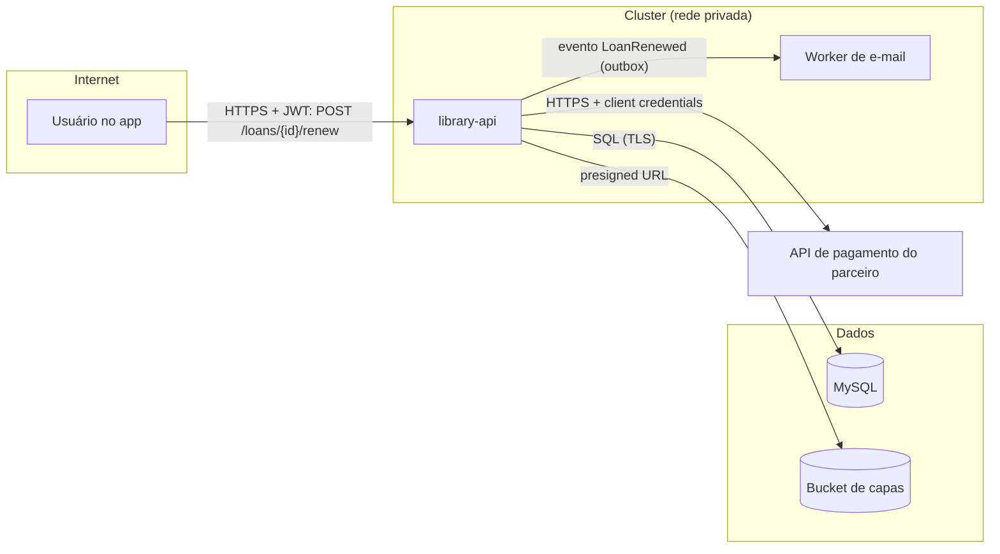

Antes de aplicar este pattern, leia também [`../application-security/SKILL.md`](../application-security/SKILL.md) (as mitigações técnicas), [`../authentication/SKILL.md`](../authentication/SKILL.md) e [`../privacy-lgpd/SKILL.md`](../privacy-lgpd/SKILL.md). Requisitos e escopo: [`../prd-writing/SKILL.md`](../prd-writing/SKILL.md), [`../user-stories/SKILL.md`](../user-stories/SKILL.md). Decisões estruturais: [`../microservices/SKILL.md`](../microservices/SKILL.md) e o agent `architect`.

# Modelagem de ameaças

**Modelar ameaças é pensar em como a feature pode ser abusada antes de escrevê-la** — quando corrigir custa uma linha no PRD, não uma migração em produção. Não é um documento de 40 páginas nem uma auditoria: para uma feature típica, **30 a 60 minutos** com quem constrói (dev/tech lead), quem testa (QA) e quem decide o escopo (PM).

## 1. Quando fazer

| Faça | Pode pular |
|---|---|
| Feature que mexe com **autenticação, autorização ou sessões** | Ajuste visual, texto, correção trivial |
| **Dados pessoais** ou sensíveis (`privacy-lgpd`) | CRUD interno sem dado sensível, igual a outros já modelados |
| **Dinheiro**, créditos, cupons, limites | Refatoração sem mudança de comportamento (`refactoring`) |
| **Arquivos** enviados por usuários, importação | |
| **Integração externa** (webhook recebido, API de parceiro, URL informada pelo usuário) | |
| Mudança de **arquitetura** (novo serviço, fila, banco, exposição pública) | |
| Fluxos que podem ser **automatizados por abusadores** (cadastro, login, envio de e-mail) | |

Modele também quando um incidente ou pentest mostrar uma classe de falha nova — e atualize os modelos afetados.

---

## 2. As quatro perguntas

1. **No que estamos trabalhando?** — um diagrama simples (seção 3).
2. **O que pode dar errado?** — STRIDE em cada elemento e fluxo (seção 4) e casos de abuso (seção 5).
3. **O que vamos fazer a respeito?** — para cada ameaça: mitigar, aceitar (com dono e motivo), transferir ou eliminar a funcionalidade (seção 6).
4. **Fizemos um bom trabalho?** — as mitigações viraram tarefas e testes; o modelo é revisado quando a feature muda (seção 8).

---

## 3. Diagrama com fronteiras de confiança

Desenhe **só** o que importa para a feature: quem chama, os processos, onde os dados ficam, e as **fronteiras de confiança** (onde o nível de confiança muda — internet → API, API → banco, sua conta → parceiro). Mermaid fica no próprio documento:


Cada seta que **cruza uma fronteira** é onde as ameaças se concentram: entrada não confiável, credenciais em trânsito, respostas de terceiros.

---

## 4. STRIDE por elemento

Passe por cada elemento e cada fluxo do diagrama perguntando as seis categorias:

| Categoria | Pergunta | Exemplos numa API Spring Boot | Mitigação típica (skill) |
|---|---|---|---|
| **S**poofing (falsificação de identidade) | Alguém pode se passar por outro usuário ou serviço? | Token sem verificação de assinatura; header `X-User-Id` aceito do client; webhook sem assinatura | JWT verificado (`authentication`, `aws-cognito`); identidade do `SecurityContext`; HMAC no webhook; mTLS/client credentials entre serviços (`service-communication`) |
| **T**ampering (adulteração) | Alguém pode alterar dados em trânsito, no banco ou na requisição? | Mass assignment de `role`/`price`; preço calculado no front; mensagem de fila alterada | DTO de request restrito, preço recalculado no servidor (`application-security`); TLS; validação (`bean-validation`) |
| **R**epudiation (repúdio) | Alguém pode negar que fez algo, sem que possamos provar? | Renovação sem registro de quem fez; exclusão sem trilha | Log de auditoria com usuário, ação, recurso, data e trace id (`observability`) |
| **I**nformation disclosure (vazamento) | Dados podem chegar a quem não deveria? | IDOR; stack trace no erro; PII em log/evento; bucket público; listagem sem filtro por dono | Autorização por objeto (`application-security`); erros sem detalhe (`exception-handling`); minimização (`privacy-lgpd`); bucket privado (`aws-s3-sqs`) |
| **D**enial of service (negação de serviço) | Alguém pode derrubar ou degradar o serviço? | `size=1000000`; upload de 5 GB; importação de 1 milhão de linhas; chamada externa sem timeout | Limites e rate limit (`pagination`, `file-upload-download`, `application-security`); timeouts e bulkhead (`resilience`) |
| **E**levation of privilege (elevação de privilégio) | Alguém pode fazer o que seu papel não permite? | Endpoint admin sem `@PreAuthorize`; usuário renovando empréstimo de outro; SSRF para metadados da nuvem | `@PreAuthorize` + `denyAll` (`authentication`); checagem de dono; bloqueio de IPs internos (`application-security`) |

Não precisa preencher todas as células: registre só as ameaças **plausíveis**. Uma linha concreta ("usuário A renova o empréstimo do usuário B trocando o id no path") vale mais que dez genéricas.

---

## 5. Casos de abuso

Para cada história de usuário importante, escreva o **avesso**: o que um usuário mal-intencionado (ou um bot) tentaria. Eles viram critérios de aceite negativos (`user-stories`):

```
História:  Como sócio, quero renovar meu empréstimo online para não pagar multa.
Abuso 1:   Como atacante, renovo o empréstimo de outro sócio trocando o id na URL.
           → Dado o empréstimo de B, quando A chama POST /loans/{idDeB}/renew, então 404 e nada muda.
Abuso 2:   Como sócio, renovo indefinidamente com um script para nunca devolver o livro.
           → Dado um empréstimo já renovado 2 vezes, quando renovo, então 422 com a regra.
Abuso 3:   Como bot, disparo milhares de renovações para sobrecarregar o envio de e-mails.
           → Dado mais de 10 renovações por minuto do mesmo usuário, então 429.
```
Fluxos de negócio sensíveis (cupons, cadastro, recuperação de senha) costumam ser abusados **sem nenhum bug técnico** — só automação. Pense também em: repetição (clique duplo, retry — `idempotency`), ordem trocada de passos, valores no limite, e o que acontece se um passo falhar no meio (`saga-pattern`).

---

## 6. Priorizar e decidir

Uma escala simples basta — o objetivo é ordenar, não calcular risco com precisão falsa:

| Probabilidade × Impacto | Baixo impacto | Médio | Alto (vazamento de dados, fraude, indisponibilidade) |
|---|---|---|---|
| **Alta** (explorável por qualquer usuário autenticado ou anônimo) | Média | Alta | **Crítica** |
| **Média** (exige conhecimento ou condição específica) | Baixa | Média | Alta |
| **Baixa** (exige acesso interno ou cadeia de falhas) | Baixa | Baixa | Média |

Para cada ameaça, uma decisão registrada:
- **Mitigar** — vira tarefa no plano (`tech-lead`) e critério de aceite (`prd-writing`). Críticas e altas: **antes** do lançamento.
- **Aceitar** — só com **dono, motivo e data de revisão** (ex.: "aceito para o piloto com 50 usuários; revisar antes da abertura geral").
- **Transferir** — para um serviço gerenciado ou fornecedor (ex.: pagamento no provedor, não guardamos cartão).
- **Eliminar** — tirar a funcionalidade arriscada do escopo (ex.: "importar de uma URL" vira "enviar o arquivo").

Ameaças que exigem decisão estrutural (novo componente, mudança de fronteira) vão para um ADR do `architect`.

---

## 7. Template — `docs/security/threat-model-<feature>.md`

```markdown
# Threat model: <feature>

- Data: AAAA-MM-DD · Participantes: <nomes/papéis> · PRD: <link> · ADR: <link, se houver>
- Escopo: <o que está dentro e fora>

## Diagrama
<mermaid com fronteiras de confiança>

## Ativos
<o que precisa ser protegido: dados pessoais, saldo, disponibilidade, reputação>

## Ameaças
| # | Elemento/fluxo | STRIDE | Ameaça (concreta) | Prob. | Impacto | Prioridade | Decisão | Mitigação / tarefa | Teste |
|---|---|---|---|---|---|---|---|---|---|
| T1 | POST /loans/{id}/renew | E, I | A renova/lê o empréstimo de B trocando o id | Alta | Alto | Crítica | Mitigar | findByIdAndUserId; 404 | IT: IDOR renew |
| T2 | Worker de e-mail | D | Rajada de renovações gera milhares de e-mails | Média | Médio | Média | Mitigar | Rate limit 10/min por usuário | IT: 429 |

## Riscos aceitos
| # | Motivo | Dono | Revisar em |

## Perguntas em aberto
```
- Grave **com confirmação** (o `architect` grava documentos de arquitetura; o `product-manager` referencia o modelo no PRD).
- Sem segredos, credenciais ou dados pessoais reais no documento — é um arquivo do repositório.

---

## 8. Fechar o ciclo

- **Cada mitigação "Mitigar" vira uma tarefa** com skill e agent (`tech-lead`) **e um teste** (`qa`): o teste é a prova de que a ameaça foi tratada. Sem teste, a linha fica marcada como "não verificada".
- O **code review** confere as mitigações da feature (`code-reviewer`, com `application-security` como checklist).
- **Revise o modelo** quando a feature mudar de forma relevante (novo fluxo, nova integração, exposição pública), depois de um incidente, ou ao abrir para mais usuários.
- Ferramentas são opcionais: OWASP Threat Dragon ou um diagrama no próprio Markdown bastam. O valor está nas perguntas, não na ferramenta.

---

## Regras principais

- Modele antes de construir toda feature que toca autenticação, dados pessoais, dinheiro, arquivos, integrações externas ou fluxos automatizáveis — e em mudanças de arquitetura.
- Sessão curta (30–60 min) com dev/tech lead, QA e PM; responda as quatro perguntas.
- Diagrama só com o essencial, **com fronteiras de confiança**; as ameaças se concentram onde um fluxo cruza uma fronteira.
- STRIDE por elemento e fluxo, registrando só ameaças **concretas e plausíveis**.
- Casos de abuso para as histórias importantes, transformados em critérios de aceite negativos.
- Priorização simples (probabilidade × impacto) e uma decisão por ameaça; risco aceito só com dono, motivo e data de revisão.
- Toda mitigação vira tarefa **e** teste; críticas e altas resolvidas antes do lançamento.
- Documento em `docs/security/threat-model-<feature>.md`, sem segredos nem dados reais; revisado quando a feature muda.
